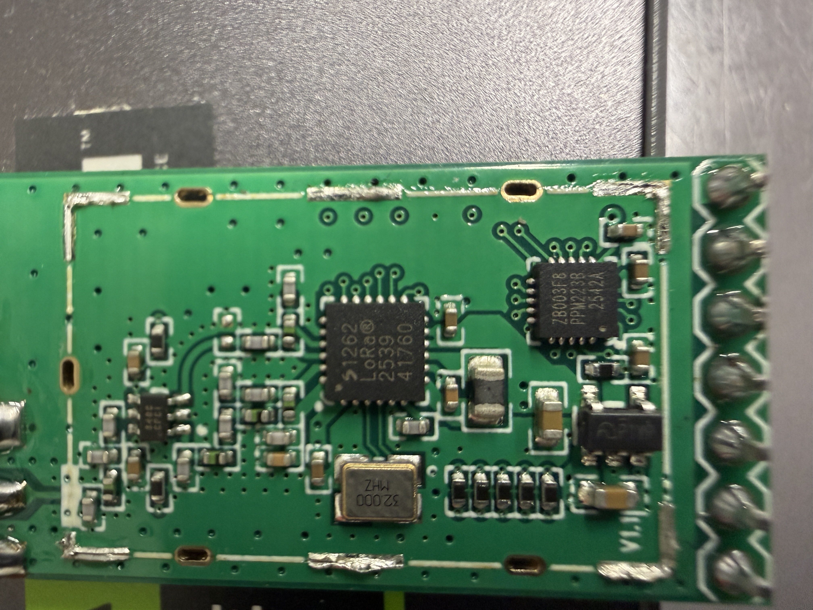
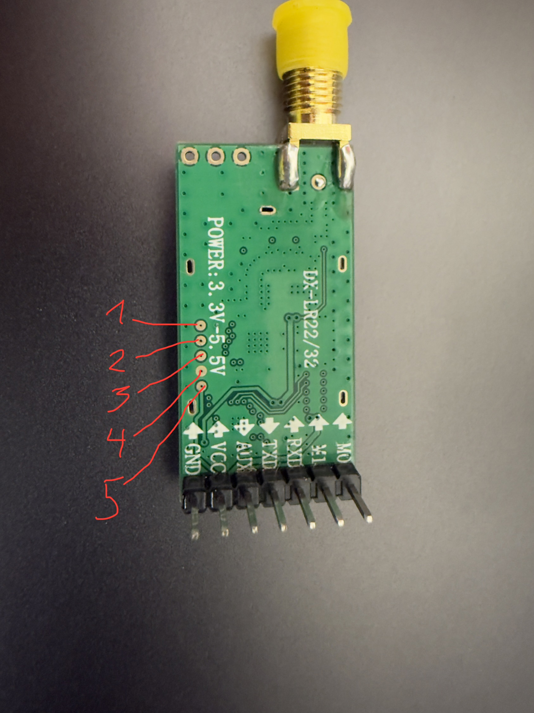
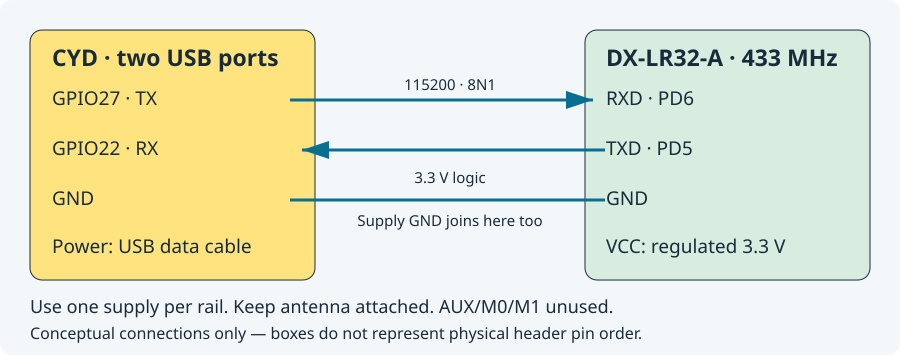

# Meshtastic DIY: CYD touchscreen + DX-LR32

Build a standalone touchscreen Meshtastic node from a **two-USB ESP32-2432S028 CYD** and a **DX-LR32-A 433 MHz LoRa module**. Send channel messages or direct messages on the screen, or connect the Meshtastic phone app over Bluetooth. A PC is needed for installation, not everyday use.

The ESP32 runs Meshtastic and the interface. Custom firmware on the DX-LR32's CX32L003F8 controls its SX1262 radio over a UART link. This is an experimental community project, **not an officially supported Meshtastic board**.

> **Before flashing:** we do **not** have a complete backup of the original DX-LR32 manufacturer firmware. Flashing replaces its original operation; this repository cannot restore it to stock. The older “recovery” images are our custom diagnostics, not factory firmware. Back up your own untouched module first if it permits reading. Never unlock read protection just to obtain a backup.

  
  

The RF shield was removed for the research photograph. **You do not need to remove it to flash through the back pads.** [Photo/pinout details](docs/hardware-photos-and-pin-counting.md).

## What you need

| Item | Exact tested hardware / purpose |
| --- | --- |
| CYD touchscreen | **ESP32-2432S028 with USB-C and micro-USB**, ESP32-D0WD-V3, 4 MB Flash, **ST7789** display, XPT2046 touch. One-USB/ILI9341 CYDs need different configuration. |
| Radio module | **DX-LR32-A 433 MHz**, CX32L003F8 controller (marked ZB003F8) + SX1262. Not an interchangeable Ebyte UART modem. |
| Antenna | Suitable 433 MHz antenna connected before any transmission. |
| ST-Link programmer | SWD access to the DX-LR32; temporary, not needed after installation. |
| Power and cables | USB data cable for CYD, a suitable regulated **3.3 V** module supply, common GND, jumper wires; soldering iron or reliable pogo connection to SWD pads. Use one supply per rail. |
| PC | Ubuntu/Linux or Windows with Ubuntu in WSL2 and USB passthrough. Source builds download tools/dependencies. |
| Recommended | Multimeter, stylus, and another correctly configured Meshtastic node for a real radio test. A separate USB–UART adapter is optional diagnostics equipment. |

## Connect the boards

| CYD pin | DX-LR32 header label | Direction |
| --- | --- | --- |
| **GPIO27** | **RXD** (MCU PD6) | CYD → radio |
| **GPIO22** | **TXD** (MCU PD5) | radio → CYD |
| **GND** | **GND** | Common ground |

UART is **115200 baud, 8N1, 3.3 V logic**. Power off before wiring. The CYD is powered over USB; the module uses its single verified supply. Do not assume the CYD's 3.3 V output can supply the module. Remove a separate USB–UART adapter's TX/RX leads when CYD is the host. AUX/M0/M1 are not required by this custom firmware. [Full wiring and first-run guide](docs/DIY_GUIDE.md).

## Install and start

There are **two different firmware images**, one for each board. A generic Meshtastic web-flasher image does not include this custom UART radio adapter. This repository currently provides a source-build route; there are no published binary release downloads yet.

1. [Prepare your PC and identify both boards](docs/DIY_GUIDE.md#1-prepare-the-pc).
2. [Back up and flash the DX-LR32 over ST-Link/SWD](docs/FLASHING_DX_LR32.md). Build the current controller with `make -C firmware mesh-check`; use **meshctrl**, not the historical default/diagnostic targets.
3. [Build and flash the CYD over USB](docs/FLASHING_CYD.md). First installation uses the **factory image at `0x0` plus matching filesystem at `0x300000`**. Later app-only updates use **`0x10000`**.
4. [Connect UART, calibrate touch, configure the node, and test](docs/DIY_GUIDE.md#4-first-start-and-radio-test). New configurations default to **EU_433 / LongFast with TX off**. Choose an appropriate regional setup and explicitly enable transmission through the phone app or USB API before testing.

The bottom controls are **Prev / Menu / Next / Chat**. Menu turns green **OK** while selecting settings. Chat lets you choose an enabled channel or known-node direct message, then Compose. Clock and System menus include manual time, display timeout, device and LoRa settings. Display sleep keeps radio/Bluetooth running; the first touch wakes the display. [All GUI controls and limits](docs/cyd-gui.md).

## What is verified

The current matched pair is **DX-LR32 controller v0.8.0** and our CYD overlay on pinned **Meshtastic 2.7.26.54e0d8d**. Physical tests confirmed channel and encrypted direct messaging with another node, delivery acknowledgements, Bluetooth messaging, touch controls and display sleep/wake. Builds and host sanitizer tests pass. [Controller evidence](docs/v0.8.0-results.md) · [CYD bring-up](docs/cyd-bringup.md) · [GUI validation](docs/cyd-gui.md).

The normal host-managed radio path uses Meshtastic's queue, CAD/channel checks and airtime policy rather than the earlier fixed test cooldown. This is still experimental: long-duration stability, full RF-switch/load characterization and comprehensive RF qualification remain unfinished. Although controller APIs accept an 868 MHz tuning window, **868 MHz RF performance is not qualified on this 433 MHz module**. Display sleep is not whole-device deep sleep. Chat history is currently bounded to ten messages total.

## Documentation and preserved research

- [DIY guide](docs/DIY_GUIDE.md) · [Troubleshooting](docs/TROUBLESHOOTING.md) · [Build/test reference](docs/BUILD.md)
- [Hardware photos, package pinouts and measurements](docs/hardware-photos-and-pin-counting.md)
- [Complete documentation and research index](docs/README.md): earlier firmware, measurements, experiments, pin corrections and test results are retained, with their historical context.
- [CYD developer notes](cyd/README.md) · [UART feature contract](docs/UART_FEATURES.md) · [Pinned dependency sources](docs/source-lock.json)

Generated binaries, downloaded dependencies and private logs/identifiers stay outside Git. This source tree does not include a stock firmware restore image. Upstream Meshtastic is GPL-3.0; dependency provenance and licensing are described in the [build reference](docs/BUILD.md#sources-and-licenses).

## Support the project

If this project helps you, you can support the hardware, testing and documentation through [Buy Me a Coffee — allar](https://buymeacoffee.com/allar). Thank you for supporting the project.
