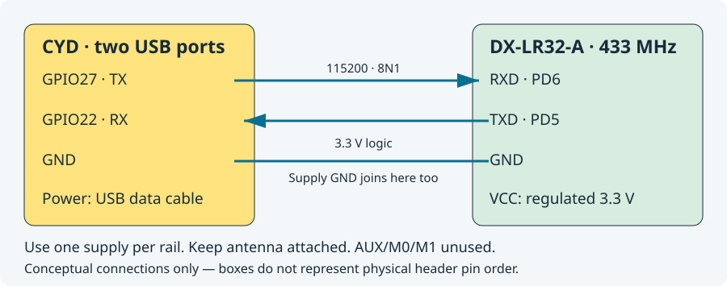

# Build your own CYD + DX-LR32 Meshtastic node

Start with the [equipment list and warning](../README.md). The exact tested CYD has **two USB connectors and an ST7789 screen**. Similar-looking one-USB/ILI9341 boards are not covered by this build. The module is DX-LR32-A 433 MHz with CX32L003F8/ZB003F8 + SX1262.

You will program two independent processors: ST-Link/SWD for the DX-LR32, then USB for the CYD. The installed pair works without a PC. No original manufacturer firmware backup is available from this project; see the [backup warning](FLASHING_DX_LR32.md#before-you-start).

## 1. Prepare the PC

The documented environment is Ubuntu/Linux or Ubuntu under WSL2. These commands run in the Ubuntu terminal, from the project root unless stated otherwise. Allow space and time for the downloaded ESP32 toolchain and upstream sources.

```sh
sudo apt-get update
sudo apt-get install --no-install-recommends \
  git build-essential gcc-arm-none-eabi binutils-arm-none-eabi \
  python3 python3-venv python3-pip autoconf automake libtool libtool-bin \
  pkg-config libusb-1.0-0-dev texinfo

git clone https://github.com/allarasp/DX-LR32_custom_firmware_for_Meshtastic.git
cd DX-LR32_custom_firmware_for_Meshtastic
python3 -m venv .venv
.venv/bin/python -m pip install -r requirements-build.txt
```

If you already have a checkout, do not clone into it or discard local work. Commands use `.venv/bin/...` so activating the environment is optional.

**WSL USB:** Windows must pass the ST-Link and CYD USB device into WSL. With usbipd-win installed, run `usbipd list` in PowerShell, identify the actual BUSID, bind it from administrator PowerShell using `usbipd bind --busid <BUSID>`, then attach using `usbipd attach --wsl --busid <BUSID>`. Replace the placeholders; CYD and ST-Link have different BUSIDs. Recheck after unplugging. In Ubuntu, `lsusb` should show ST-Link, and `ls -l /dev/ttyUSB* /dev/ttyACM*` should show the CYD serial port. Native Windows compilation/flashing is not covered by these instructions.

On native Linux, serial access may require membership in `dialout` followed by signing out/in; ST-Link may require an appropriate udev rule. Fix device permissions instead of running your entire build as root. Close serial monitors and phone/CLI connections before USB flashing.

## 2. Install the module firmware

Follow [DX-LR32 backup and flashing](FLASHING_DX_LR32.md) completely. You will connect the back SWD pads, build the CX32-aware OpenOCD tool, save a full private backup, build **meshctrl v0.8.0**, and program/readback-verify it. Keep your backup off-device too.

Do not select `uartctrl`, `radiodiag`, `uartdiag` or plain `make` as the final Meshtastic controller. Those targets preserve earlier diagnostics.

## 3. Install the CYD firmware and connect UART

Follow [CYD build and USB flashing](FLASHING_CYD.md). On first installation flash both the factory image and the matching filesystem. Complete touch calibration with a stylus or deliberate pressure, holding each cross until it disappears, then releasing before the next.

Power everything off, then connect:

| From | To |
| --- | --- |
| CYD GPIO27 (UART TX) | DX-LR32 **RXD** / MCU PD6 |
| CYD GPIO22 (UART RX) | DX-LR32 **TXD** / MCU PD5 |
| CYD GND | DX-LR32 GND and supply GND |
| One regulated 3.3 V module supply | DX-LR32 VCC |



Read the printed **RXD/TXD labels**, not an assumed left-to-right pin order. The PC7/PD1 programming pads are separate from the UART header. Module logic is 3.3 V; do not connect 5 V UART signals. The board's printed supply range is not a guarantee that every attached programmer/adapter is safe at that voltage. This project used 3.3 V for the module. Use a regulator with sufficient current headroom for radio TX; the CYD's exposed 3.3 V output was not qualified as a radio supply.

Use one power source per rail: do not join ST-Link power, an external supply and a USB–UART adapter's VCC. With external power, the programmer's voltage-reference connection must be a genuine reference input, not another power output; ST-Link clone pinouts vary. Common GND is always needed. Remove separate USB–UART TX/RX leads when CYD controls the module. AUX/M0/M1 can remain unconnected; their original stock configuration behavior is replaced.

Attach the correct antenna, then power up. Once flashing is finished, power off before removing SWD leads. ST-Link is not needed for normal operation. Future DX-LR32 firmware updates still need SWD; CYD USB updates do not.

## 4. First start and radio test

1. Confirm the top bar reports **UART ON** after the module handshake. It may take a few seconds. OFF means troubleshoot power, crossed TX/RX and common GND before testing RF.
2. Open System → LoRa settings and choose your applicable region and preset. The tested combination is **EU_433 / LongFast**, default public channel, on both nodes. Use settings appropriate to your actual hardware and location; the 433 MHz module is not RF-qualified for 868 MHz.
3. Set a recognizable node name using the phone app or USB API. Pair the official Meshtastic phone app with the CYD over Bluetooth, using the pairing code presented by the device when requested. This is the CYD node, not a separate Bluetooth radio in the module.
4. **Enable TX explicitly in the phone app's LoRa configuration and save it.** New configurations default to TX disabled. The screen's region/power controls do not enable TX. The top bar should change to TX ON. Alternatively, use the USB API below.
5. Use Chat → Channels → your enabled channel → Compose. Send a short message while another node with matching settings is nearby, then ask it to reply. Received Node Info makes peers available in Chat → Direct messages. A public-channel test is easiest before testing encrypted DMs.
6. Confirm the exact text on the other node, the reply on CYD, and delivery state. Reception alone does not prove CYD transmission. A channel delivery confirmation can come from a rebroadcast; a direct-message acknowledgement is a separate test.
7. Try System → Screen on for → 1 minute → Save. After the display goes dark, the first touch should wake it without selecting an item. Bluetooth and radio should remain active.

Optional USB API configuration (replace the actual serial port and close any serial monitor first):

```sh
.venv/bin/python -m pip install -r requirements-meshtastic.lock
.venv/bin/meshtastic --port /dev/ttyUSB0 --info
.venv/bin/meshtastic --port /dev/ttyUSB0 --set lora.tx_enabled true
```

Menu opens the current page's menu; in menus it becomes green **OK**. Prev/Next move selection or adjust an editor; save changes explicitly. Clock settings allow manual time and timezone; manual time does not survive complete power loss without a backed clock or later synchronization. Chat history is limited to ten messages total, and unread counters reset on reboot. See [GUI reference](cyd-gui.md).

If anything fails, use [troubleshooting](TROUBLESHOOTING.md). No fixed 30-second waiting rule is required by the current matched pair; normal Meshtastic airtime/channel policy can still defer traffic.
