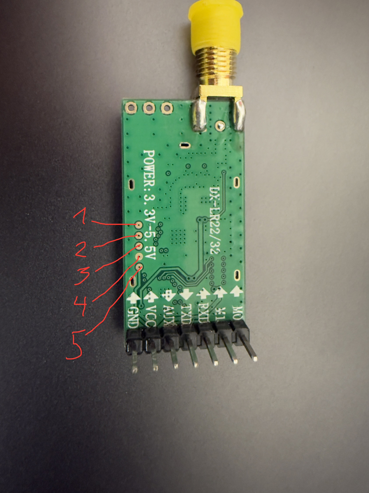

# Back up and flash the DX-LR32

This procedure is for the **DX-LR32-A 433 MHz with CX32L003F8 (ZB003F8 marking)**. Do not apply it to a different chip simply because an ST-Link connects. The Cortex-M CPUID does not uniquely identify this MCU.

## Before you start

**There is no complete original manufacturer firmware backup in this project.** Earlier mixed dumps contain our firmware and surviving factory remnants; they cannot restore a stock module. The v0.3.1 “recovery” image is a custom diagnostic, not stock firmware. If your module is untouched and readable, the backup below preserves its present 64 KB main Flash. That is not a promise of a complete vendor recovery mechanism or a backup of every protected/calibration region.

If reads fail or protection differs, **stop**. Do not run an unlock, option-byte write, mass erase or a generic “recover device” command. Unlocking can destroy the very firmware you want to preserve. Keep backups private: they include unique device identity. The helper records UID/protection separately but never writes those regions.

[Prepare Ubuntu and build tools first](DIY_GUIDE.md#1-prepare-the-pc). Commands below run from this repository root. No build command accesses hardware; `backup` and `flash` explicitly do.

## 1. Connect SWD with power off



In this photograph the antenna connector is at the top, header at the bottom. Use the red pad numbers; **these are not MCU package pin numbers**.

| Photo pad | Signal | ST-Link connection |
| --- | --- | --- |
| 1 | NRST, MCU pin 1 | Optional; tested workflow uses core reset without this lead |
| 2 | SWCLK / PD1, MCU pin 15 | SWCLK |
| 3 | SWDIO / PC7, MCU pin 14 | SWDIO |
| 4 | GND | GND |
| 5 | VCC / VDD | Module's single 3.3 V supply rail; see power note |

**Power note:** use one verified 3.3 V supply. If the module is externally powered, do not also connect a programmer's 3.3 V power **output**. A genuine ST-Link target-voltage reference **input** is different from a clone's power pin. Confirm your programmer pinout before connecting. Do not feed 5 V into the target debug logic. Check continuity and shorts while unpowered, then power up. Shield removal is unnecessary.

## 2. Build the CX32-aware OpenOCD

Ordinary distribution OpenOCD is not the tested CX32 Flash programmer. Use this pinned fork and rebuilt RAM loader, rather than a generic STM32 target. These commands prepare software only:

```sh
git clone https://source.haeckserei.de/nica/openocd-code.git src/openocd-code
git -C src/openocd-code checkout --detach 2431daa7992436f61ea49d2d54308b61f08fbbee
git -C src/openocd-code submodule update --init jimtcl
openocd_prefix="$PWD/tools/openocd-cx32"
(cd src/openocd-code && ./bootstrap nosubmodule && \
  ./configure --prefix="$openocd_prefix" --enable-internal-jimtcl \
    --enable-stlink --disable-jlink --disable-werror \
    --disable-doxygen-html --disable-doxygen-pdf)
python3 bin/rebuild-cx32-loader.py
make -C src/openocd-code -j4
make -C src/openocd-code install
```

If the source/tool directory already exists, inspect it instead of cloning over it. The loader helper rebuilds from inspected source with an aligned stack; it does not flash a device. [Tool/dependency details](BUILD.md).

## 3. Save your module's present firmware

Confirm the exact physical MCU/module and wiring, attach ST-Link to Linux/WSL, and close other OpenOCD sessions. Choose a new backup directory each time:

```sh
python3 bin/flash_dxlr32.py backup \
  --confirm-chip CX32L003F8 \
  --output backups/my-dxlr32-before-first-flash
```

Success creates `flash.bin` (65,536 bytes), CPUID, UID and USERCFG dumps, SHA-256 manifest and OpenOCD logs. Copy this entire directory somewhere safe. The script halts the MCU to read it and resumes it after a successful backup; a failed operation can leave it halted. `backups/` is excluded from Git.

The helper accepts only the tested CPUID and all-ones USERCFG state and refuses incomplete reads. This conservative check does not turn OpenOCD's missing protection callback into comprehensive protection detection. Unexpected hardware or a different configuration requires investigation, not bypassing checks.

## 4. Build the current controller

```sh
python3 firmware/tools/prepare_deps.py
make -C firmware mesh-check
```

Use `firmware/build/meshctrl/controller.bin`. The current v0.8.0 reference image is **20,476 bytes**, SHA-256:

```text
6a1230183c8e96c47d7b91c00e2ddb09141ade0317e2249eda69576b0f875ff6
```

Different compilers or source changes can change the binary; investigate an unexpected difference instead of treating a matching filename as sufficient. `mesh-check` runs host tests and image validation. **Plain `make` builds an earlier experimental foundation, not this deployment target.**

## 5. Program and verify

This command explicitly overwrites the module's main firmware. Connect the antenna and keep power stable. Use the exact backup made from this module's current contents:

```sh
python3 bin/flash_dxlr32.py flash \
  --confirm-chip CX32L003F8 --confirm-overwrite \
  --backup-dir backups/my-dxlr32-before-first-flash \
  --image firmware/build/meshctrl/controller.bin
```

The helper validates vectors and backup hashes; captures the current target again; requires matching identity, protection state **and present Flash contents**; guards identity again immediately before the write; erases only sectors needed for this image; dumps the written bytes; and compares them on the PC before resetting/resuming. It does not use the target RAM checksum routine for verification. Main Flash starts at `0x00000000`; option/UID/ISP regions are not programming destinations.

The SWD programming/readback method was exercised on the project board. This reusable wrapper adds offline-tested backup/identity guards; it has not been qualified across other hardware revisions. A failure is a reason to inspect the retained logs, power and target. Do not repeatedly erase, weaken checks or switch to another chip's programming algorithm.

Programming evidence is retained inside your backup directory. On future updates, make a **new** backup of the currently installed firmware, then use that backup for the flash command. A backup predating an intervening firmware update is deliberately rejected.

## 6. Continue with CYD

Power off before moving/removing leads. ST-Link and SWD wires are unnecessary in normal operation, but SWD access will be needed for later module firmware changes. [Flash the CYD](FLASHING_CYD.md), then [wire and test both boards](DIY_GUIDE.md#3-install-the-cyd-firmware-and-connect-uart).
