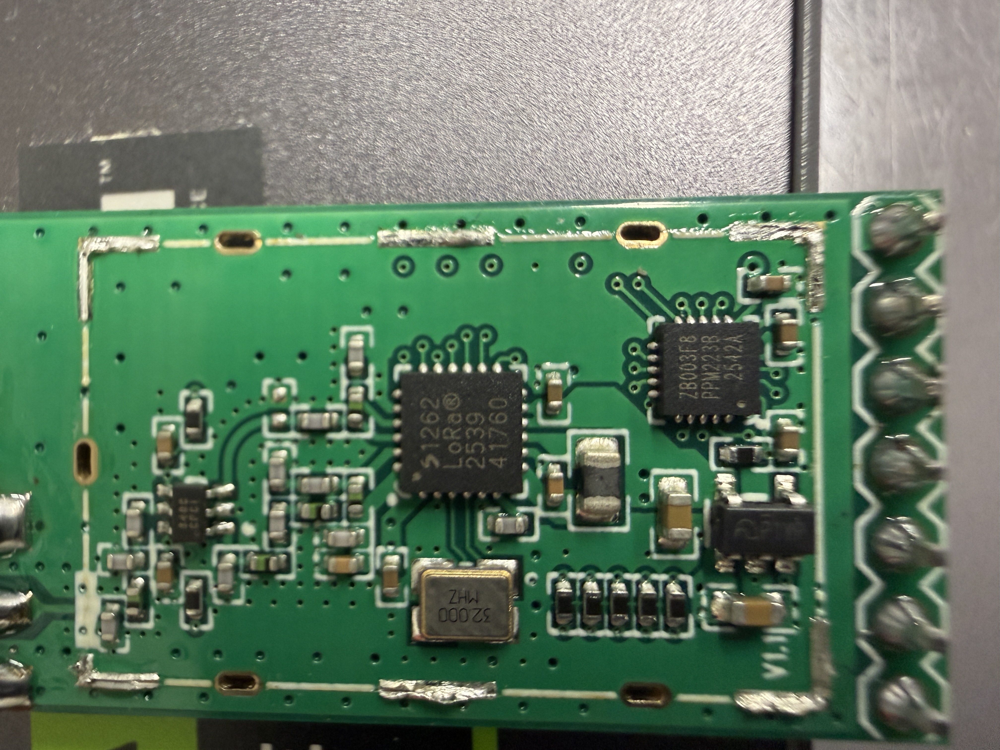
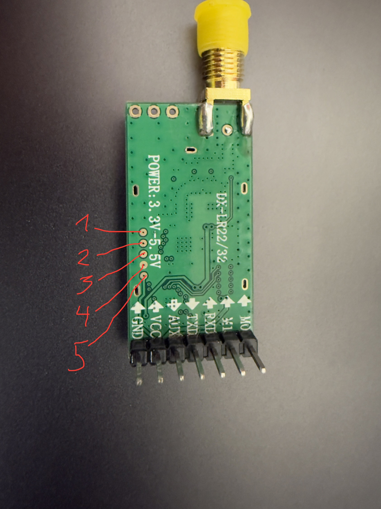
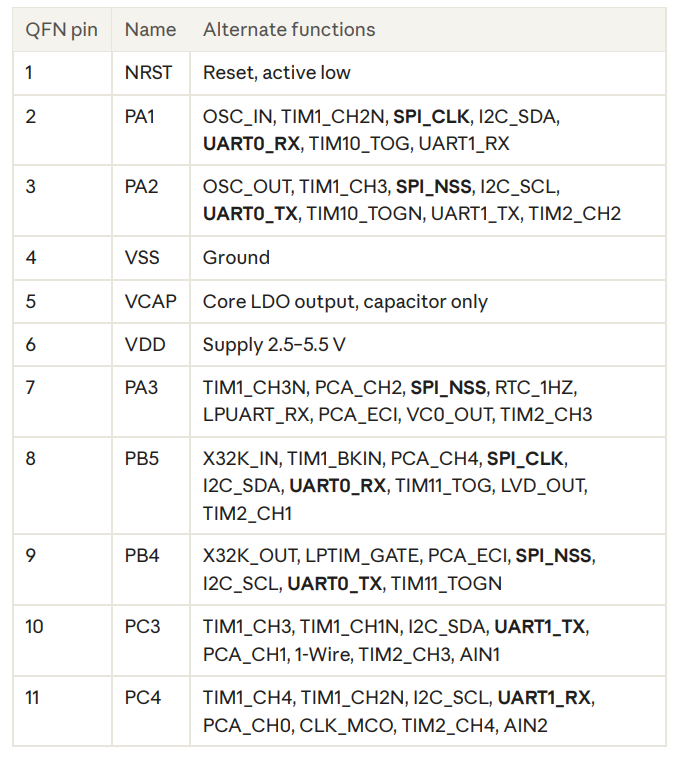
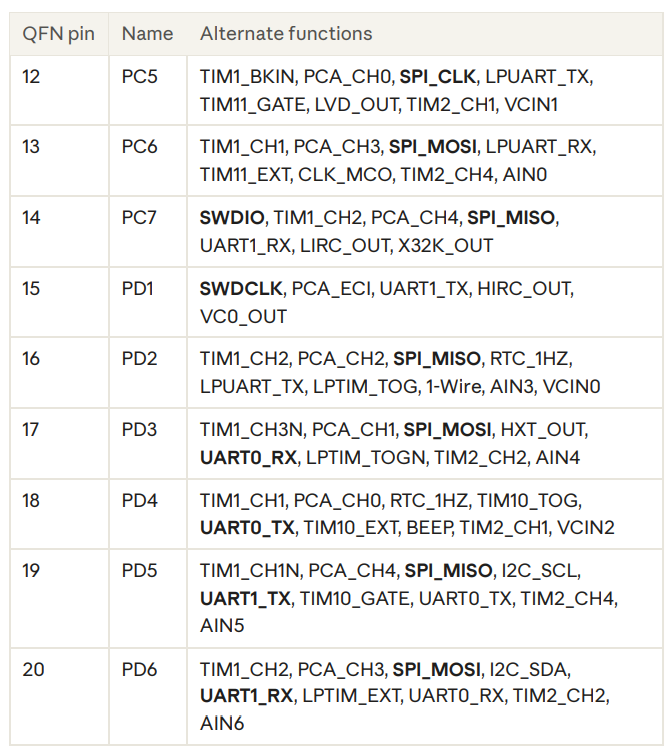
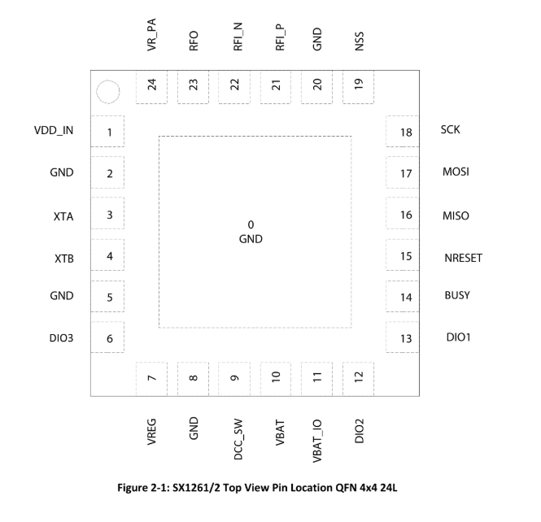

# DX-LR32-A PCB photos and IC pin numbering

The hardware photos in this project were taken **after removing the metal RF shielding can** from the DX-LR32-A module. The removal exposes the Semtech SX1262 transceiver, the CX32L003F8 controller and surrounding RF components. The RF shield was removed for inspection only; this modification may affect RF shielding and performance. **It is not required for back-pad SWD flashing.**

## How to count IC pins

**Look at the top of the IC package**, with the printed marking facing you. Find the small **dot / pin-1 indicator** near a corner of the package. The pad closest to the designated pin-1 corner is **pin 1**. From pin 1, **count successive pins counterclockwise when viewed from above** (looking at the top of the package).

- This is the convention for these QFN packages; do **not** count clockwise from the top view.
- Count the physical pads around the outside of the package; the large exposed center ground/thermal pad is **not** included.
- Check the specific manufacturer's **top-view package drawing** before probing: orientation and exact placement of the pin-1 indicator must match the device.
- A **bottom-view drawing** reverses the apparent counting direction. Do not use bottom-view numbering on a top-view photograph.
- The DX-LR32 **external header pins** and the **five SWD programming pads** have separate numbering, unrelated to the IC's package pins.

### CX32L003F8 — QFN20

- Small controller marked `ZB003F8` / `CX32L003F8`.
- **20 peripheral pins**; five per edge.
- In the top view, start from the pin-1 dot, then count **counterclockwise**.
- Key pins: **1 NRST**, **2 PA1**, **3 PA2**, **4 VSS**, **6 VDD**, **8 PB5**, **9 PB4**, **14 PC7 / SWDIO**, **15 PD1 / SWDCLK**, **16 PD2**, **17 PD3**, **18 PD4**, **19 PD5**, **20 PD6**.

### SX1262 — QFN24

- Larger Semtech radio transceiver.
- **24 peripheral pins**, six per edge, plus exposed ground pad.
- In the manufacturer's top view, start at pin-1 indicator and count **counterclockwise**.
- Key pins: **6 DIO3**, **12 DIO2**, **13 DIO1**, **14 BUSY**, **15 NRESET**, **16 MISO**, **17 MOSI**, **18 SCK**, **19 NSS**.

## Verified SX1262 ↔ CX32 connections

The table uses **physical package pin numbers**, not GPIO number indices.

| SX1262 signal | SX1262 physical pin | CX32 port | CX32 physical pin | Evidence |
|---|---:|---|---:|---|
| NSS | 19 | PA2 | 3 | Multimeter tracing / working SPI |
| SCK | 18 | PA1 | 2 | Multimeter tracing / working SPI |
| MOSI | 17 | PD3 | 17 | Multimeter tracing / working SPI |
| MISO | 16 | PD2 | 16 | Multimeter tracing / working SPI |
| **NRESET** | **15** | **PB4** | **9** | **Corrected using factory-code analysis; physically tested in v0.2.1** |
| **BUSY** | **14** | **PB5** | **8** | **Corrected using factory-code analysis; physically tested in v0.2.1** |
| DIO1 | 13 | PD4 | 18 | Multimeter tracing; later live RX/TX verified (see v0.8.0 results) |

**Important:** The first continuity-based interpretation had NRESET and BUSY swapped. The **correct mapping is NRESET → PB4 (CX32 physical pin 9), BUSY → PB5 (physical pin 8)**. v0.2.1 confirmed reset and SX1262 command responses. See [factory pin correction](factory-pin-correction.md).

## SWD pads on the back

The five vertically stacked, round pads on the PCB reverse side were numbered in the annotated user photograph:

| Annotated pad number | Signal | CX32 physical pin |
|---:|---|---:|
| 1 | NRST | 1 |
| 2 | SWDCLK / PD1 | 15 |
| 3 | SWDIO / PC7 | 14 |
| 4 | GND | VSS |
| 5 | VCC | VDD |

**Note:** SWD pad numbers 1–5 refer to the five points marked on the module's **back-side photo**, not QFN pin numbers.

## Actual images and package references

| Image | Subject |
| --- | --- |
| [Component photograph](images/dx-lr32-front-unshielded.jpeg) | Recovered full-resolution color photograph from the original DNG in Git history |
| [Numbered SWD pads](images/dx-lr32-swd-pads-annotated.jpeg) | Original annotated user photograph; pad numbers match the table above |
| [CX32 pinout](images/cx32l003f8-pinout.png) | Uploaded MCU reference |
| [CX32 alternate pinout](images/cx32l003f8-pinout-alternate.png) | Second uploaded MCU reference |
| [SX1262 pinout](images/sx1262-pinout.png) | Uploaded transceiver reference |

These references must be read with their package/view orientation, not assumed to be physical header diagrams. [Image recovery and provenance](research/image-provenance.md). The earlier placeholder photo list remains [archived](research/photo-index-before-image-recovery.md); its unprovided close-up/product images were never present and are not invented here.

## External header and host wiring

| Module signal | MCU port / physical pin | Use with CYD |
| --- | --- | --- |
| TXD | PD5 / 19 | To CYD GPIO22 (RX) |
| RXD | PD6 / 20 | From CYD GPIO27 (TX) |
| AUX | PA3 / 7 | Unused by the current adapter |
| M1 | PC6 / 13 | Unused by the current adapter |
| M0 | PC5 / 12 | Unused by the current adapter |

Each of the five signal lines has a measured **100 Ω series resistor**. VCC and GND are separate supply connections. The custom firmware replaces the original AUX/M0/M1 and UART behavior. [Complete wiring/power guide](DIY_GUIDE.md#3-install-the-cyd-firmware-and-connect-uart).

## Measurement notes

Trace with the target unpowered. Never rely solely on visual trace-following or a continuity beeper for small-package connections; confirm resistance and the relevant datasheets. Do not infer TCXO/DIO3 or RF-switch/DIO2 connections from these photos alone.

Standby-RC SPI checks first passed with v0.2.1. Later firmware verified real RX/TX, peer interoperability and standalone CYD messaging; see [v0.8.0 evidence](v0.8.0-results.md). The passive 32 MHz crystal requires DIO3 TCXO control to remain disabled. RF-switch component identity/load and sustained RF qualification remain open; historical measurements are retained in [RF-switch research](rf-switch-investigation.md).
