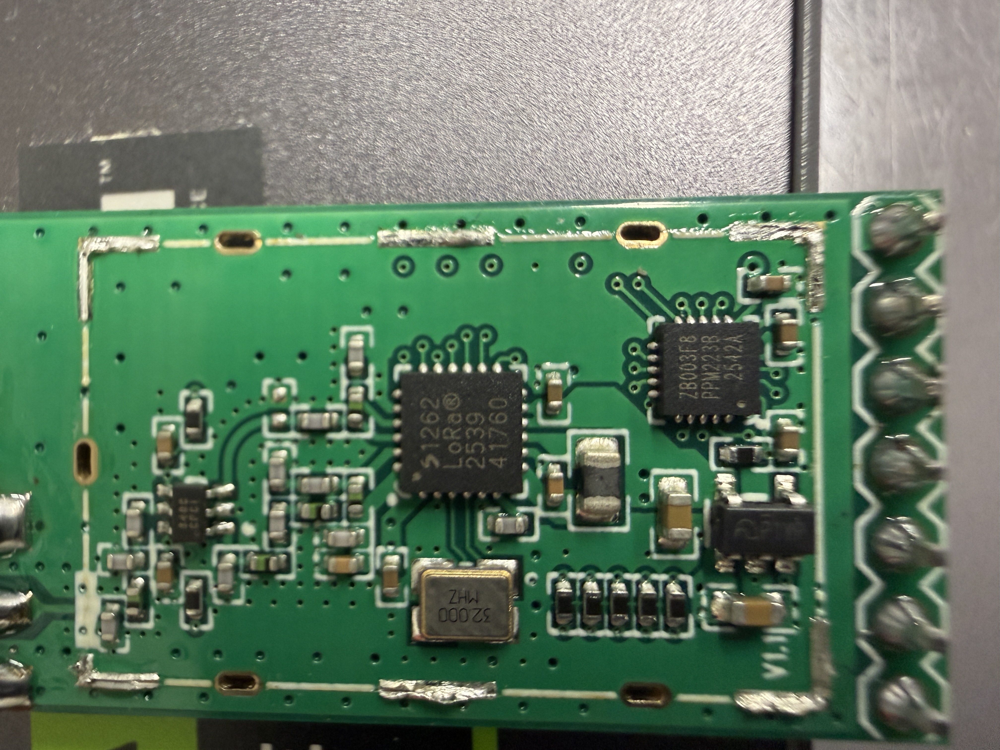
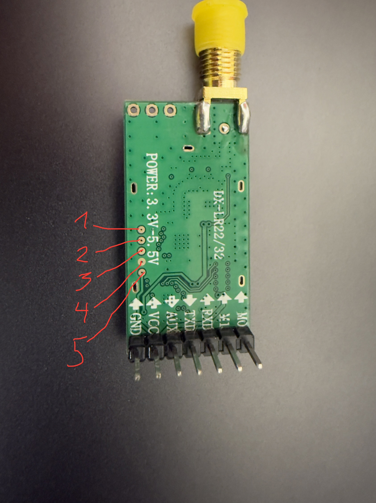

> Historical snapshot retained on 2026-11-05. Statements describe earlier stages; use the [current project guide](../../README.md) for building today.

# DX-LR32-A PCB photos and IC pin numbering

The hardware photos in this project were taken **after removing the metal RF shielding can** from the DX-LR32-A module. The removal exposes the Semtech SX1262 transceiver, the CX32L003F8 controller and surrounding RF components. The RF shield was removed for inspection only; this modification may affect RF shielding and performance.

## How to count IC pins

**Look at the top of the IC package**, with the printed marking facing you. Find the small **dot / pin-1 indicator** near a corner of the package. The pad closest to the designated pin-1 corner is **pin 1**. From pin 1, **count successive pins counterclockwise when viewed from above** (looking at the top of the package).

- This is the convention for these QFN packages; do **not** count clockwise from the top view.
- Count the physical pads around the outside of the package; the large exposed center ground/thermal pad is **not** included.
- Check the specific manufacturer's **top-view package drawing** before probing: orientation and exact placement of the pin-1 indicator must match the device.
- A **bottom-view drawing** reverses the apparent counting direction. Do not use bottom-view numbering on a top-view photograph.
- The DX-LR32 **external header pins** and the **five SWD programming pads** have separate numbering, unrelated to the IC's package pins.

### CX32L003F8 — QFN20

- Small controller marked `ZB003F8` / `CX32L003F8`.
- **20 peripheral pins**; five per edge.
- In the top view, start from the pin-1 dot, then count **counterclockwise**.
- Key pins: **1 NRST**, **2 PA1**, **3 PA2**, **4 VSS**, **6 VDD**, **8 PB5**, **9 PB4**, **14 PC7 / SWDIO**, **15 PD1 / SWDCLK**, **16 PD2**, **17 PD3**, **18 PD4**, **19 PD5**, **20 PD6**.

### SX1262 — QFN24

- Larger Semtech radio transceiver.
- **24 peripheral pins**, six per edge, plus exposed ground pad.
- In the manufacturer's top view, start at pin-1 indicator and count **counterclockwise**.
- Key pins: **6 DIO3**, **12 DIO2**, **13 DIO1**, **14 BUSY**, **15 NRESET**, **16 MISO**, **17 MOSI**, **18 SCK**, **19 NSS**.

## Verified SX1262 ↔ CX32 connections

The table uses **physical package pin numbers**, not GPIO number indices.

| SX1262 signal | SX1262 physical pin | CX32 port | CX32 physical pin | Evidence |
|---|---:|---|---:|---|
| NSS | 19 | PA2 | 3 | Multimeter tracing / working SPI |
| SCK | 18 | PA1 | 2 | Multimeter tracing / working SPI |
| MOSI | 17 | PD3 | 17 | Multimeter tracing / working SPI |
| MISO | 16 | PD2 | 16 | Multimeter tracing / working SPI |
| **NRESET** | **15** | **PB4** | **9** | **Corrected using factory-code analysis; physically tested in v0.2.1** |
| **BUSY** | **14** | **PB5** | **8** | **Corrected using factory-code analysis; physically tested in v0.2.1** |
| DIO1 | 13 | PD4 | 18 | Multimeter tracing; IRQ operation still to be tested |

**Important:** The first continuity-based interpretation had NRESET and BUSY swapped. The **correct mapping is NRESET → PB4 (CX32 physical pin 9), BUSY → PB5 (physical pin 8)**. v0.2.1 confirmed reset and SX1262 command responses. See [factory pin correction](../factory-pin-correction.md).

## SWD pads on the back

The five vertically stacked, round pads on the PCB reverse side were numbered in the annotated user photograph:

| Annotated pad number | Signal | CX32 physical pin |
|---:|---|---:|
| 1 | NRST | 1 |
| 2 | SWDCLK / PD1 | 15 |
| 3 | SWDIO / PC7 | 14 |
| 4 | GND | VSS |
| 5 | VCC | VDD |

**Note:** SWD pad numbers 1–5 refer to the five points marked on the module's **back-side photo**, not QFN pin numbers.

## Hardware photo index

The following filenames are used for the image assets once copied into `docs/images/`:

| Filename | Subject |
|---|---|
| `dx-lr32-front-unshielded.jpeg` | Component side of DX-LR32 PCB with metal shielding removed |
| `dx-lr32-rf-closeup.jpeg` | Detail view of RF components after shield removal |
| `dx-lr32-chip-markings.jpeg` | Close-up of SX1262 and CX32 controller markings |
| `dx-lr32-swd-pads-annotated.jpeg` | Reverse side, with SWD test pads numbered 1–5 in red |
| `st-link-v2-example.png` | Reference product image of ST-Link V2 (not a PCB shield-removal photo) |

Once those images are in the repository, their Markdown references can be:

```md





```

## Measurement notes

Trace with the target unpowered. Never rely solely on visual trace-following or a continuity beeper for small-package connections; confirm resistance and the relevant datasheets. Do not infer TCXO/DIO3 or RF-switch/DIO2 connections from these photos alone.

SX1262 standby-RC SPI checks succeed with firmware v0.2.1, but **RF transmission and reception are not yet verified**.
